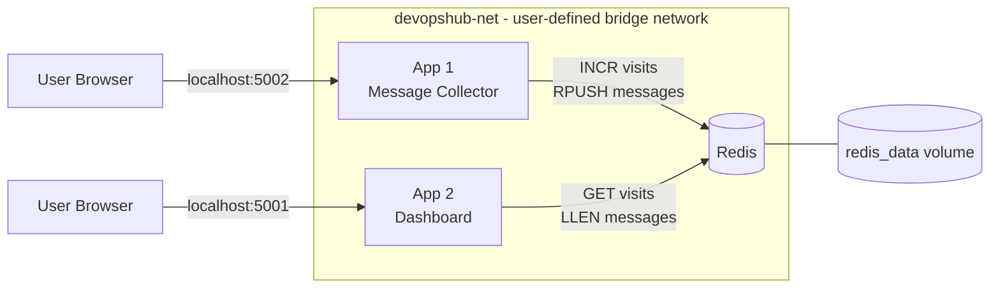

# DevOpsHub Feedback System

A simple feedback collection system built with two Node.js web apps sharing one Redis database, all running with Docker Compose.

**Course:** Cloud Computing and DevOps Engineering – Midterm Project
**Instructor:** M.Sc. Abdelhakim Rashid

---

## 1. Student Information

| Field | Value |
|---|---|
| First_Student | `Mohamed Ramy Elsherife 5882` |
| Second_Student | `Ramdan Hussain Ramdan 4674` |
| GitHub Repository | `https://github.com/YOUR-USERNAME/YOUR-REPO` |

---

## 2. Project Description

**DevOpsHub** is a small startup that wants to collect feedback from website visitors and track how many people visit the feedback page.

This project provides two web apps and one database:

| Service | Role | What it does |
|---|---|---|
| **Redis** | Shared database | Stores the messages (list) and the visit counter (key) |
| **App 1 – Message Collector** | Producer + Counter | Shows a form, counts every page visit, saves submitted messages |
| **App 2 – Dashboard** | Observer (read-only) | Shows total messages and total visits |

All data is **persistent** (stored in a Docker volume) and all services talk to each other **by name**, not by IP.

---

## 3. Architecture



- All three containers are on the user-defined bridge network `devopshub-net`.
- Docker's built-in DNS resolves the name `redis` to the Redis container's IP.
- Redis data is saved in the named volume `redis_data`, so it survives restarts.

---

## 4. How the Apps Interact with Redis

Both apps use the **same two keys**:

| Redis Key | Type | Meaning |
|---|---|---|
| `visits` | String (number) | Total number of visits to App 1 |
| `messages` | List | All submitted messages |

| App | Redis commands | Purpose |
|---|---|---|
| App 1 | `INCR visits` | Add 1 on every page load (atomic) |
| App 1 | `RPUSH messages <text>` | Append the submitted message to the list |
| App 2 | `LLEN messages` | Count the messages |
| App 2 | `GET visits` | Read the visit count |

Both apps connect using the service name:

```
redis://redis:6379
```

---

## 5. Project Structure

```
DevOpsHub/
├── app1/
│   ├── app.js            # Message Collector
│   ├── package.json
│   └── Dockerfile
├── app2/
│   ├── app.js            # Dashboard
│   ├── package.json
│   └── Dockerfile
├── screenshots/
│   ├── 1-docker-compose-ps.png
│   ├── 2-app1-browser.png
│   └── 3-app2-browser.png
├── docker-compose.yml
└── README.md
```

---

## 6. Prerequisites

- Docker Desktop (Windows/macOS) or Docker Engine (Linux)
- Docker Compose v2 (`docker compose`)
- Git
- Internet connection (to pull images from Docker Hub)

Check your installation:

```bash
docker --version
docker compose version
```

---

## 7. Step-by-Step Solution

### Step 1: Clone the repository

```bash
git clone https://github.com/YOUR-USERNAME/YOUR-REPO.git
cd YOUR-REPO
```

### Step 2: Review the project files

Make sure `app1/` and `app2/` each contain `app.js`, `package.json`, and `Dockerfile`, and that `docker-compose.yml` is in the root folder.

### Step 3: Build and start all services

```bash
docker compose up -d --build
```

This will:
- Build the images for App 1 and App 2
- Pull the Redis image
- Create the network `devopshub-net` and the volume `redis_data`
- Start the three containers in the background

### Step 4: Verify the services are running

```bash
docker compose ps
```

All three services (`redis`, `app1`, `app2`) must show **Up**.

### Step 5: Test the applications

1. Open App 1 and refresh the page a few times.
2. Submit a few messages using the form.
3. Open App 2 and check that the visits and messages counts match.

### Step 6: Verify communication by name

```bash
docker compose exec app1 nslookup redis
docker compose exec app2 nslookup redis
```

Both commands resolve `redis` to the same IP address, which proves the services communicate by name.

### Step 7: Verify data persistence

```bash
docker compose down
docker compose up -d
```

Open App 2 again: the numbers are unchanged.
> Do **not** use `docker compose down -v`, because `-v` deletes the volume and all saved data.

### Step 8: Stop the project

```bash
docker compose down
```

---

## 8. docker-compose.yml

```yaml
services:
  redis:
    image: redis:latest
    command: redis-server --appendonly yes
    volumes:
      - redis_data:/data
    networks:
      - devopshub-net

  app1:
    build: ./app1
    ports:
      - "5002:3000"
    depends_on:
      - redis
    networks:
      - devopshub-net

  app2:
    build: ./app2
    ports:
      - "5001:3000"
    depends_on:
      - redis
    networks:
      - devopshub-net

networks:
  devopshub-net:
    driver: bridge

volumes:
  redis_data:
```

**Key points:**
- `--appendonly yes` makes Redis write every change to disk (persistence).
- `redis_data:/data` stores that data in a named volume.
- `devopshub-net` is a user-defined bridge network that provides name-based DNS.
- App 1 uses host port **5002** because port 5000 was blocked on Windows.

---

## 9. Dockerfile for App 1

```dockerfile
FROM node:22-alpine
WORKDIR /app
COPY package*.json ./
RUN npm install
COPY . .
EXPOSE 3000
CMD ["npm", "start"]
```

## 10. Dockerfile for App 2

```dockerfile
FROM node:18-alpine
WORKDIR /app
COPY package*.json ./
RUN npm install
COPY . .
EXPOSE 3000
CMD ["npm", "start"]
```

**Why copy `package*.json` first?** Docker caches each step. If only the code changes, `npm install` is not repeated, so builds are faster.

---

## 11. Docker Images

| Image | Source | Used by |
|---|---|---|
| `devopshub-app1` | Built from `./app1` | App 1 |
| `devopshub-app2` | Built from `./app2` | App 2 |
| `redis:latest` | Docker Hub (official) | Redis |

List them with:

```bash
docker images
```

---

## 12. Access Instructions

| Application | URL |
|---|---|
| App 1 – Message Collector | http://localhost:5002 |
| App 2 – Dashboard | http://localhost:8001 |
| Redis | Internal only (port 6379, not exposed to the host) |

---

## 13. Screenshots

### Screenshot 1: `docker compose ps` (all services Up)


### Screenshot 2: App 1 in the browser


### Screenshot 3: App 2 in the browser


---

## 14. Troubleshooting

| Problem | Cause | Solution |
|---|---|---|
| `ports are not available: 0.0.0.0:5000` | Port blocked/reserved on Windows | Use another host port (this project uses 5002) |
| `Cannot find module '/app/app.js'` | Entry file has a different name | Rename the file to `app.js` or update `package.json` |
| Containers exit right after start | Error in code or in the Redis connection | Run `docker compose logs <service>` |
| Numbers reset to 0 | Volume was deleted | Avoid `docker compose down -v` |

---

## 15. Tech Stack

Node.js, Express, Redis, Docker, Docker Compose